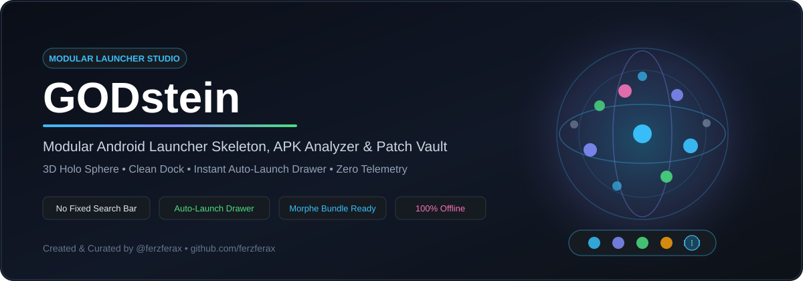
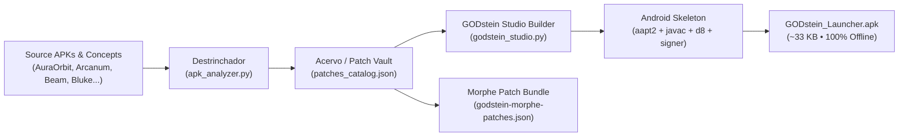

<p align="center">
  
</p>

<p align="center">
  
  
  
  
  
</p>

# ⚡ GODstein — Modular Launcher Studio & Skeleton APK

**GODstein** is an open-source modular Android launcher studio and clean skeleton APK builder created by **[@ferzferax](https://github.com/ferzferax)**.  
It solves a common frustration among Android power users: loving one standout feature from a launcher (such as a **3D Holo Sphere**) while hating intrusive fixed search bars, broken drawer keyboards, bloatware, telemetry, or missing **Auto-Launch** search.

Instead of being locked into a single bloated launcher, **GODstein Studio** lets you:
1. **Inspect & Dissect (`Destrinchador`):** Analyze any Android APK to map permissions, telemetry/ad trackers, and modular UI patterns.
2. **Curate a Patch Vault (`Acervo`):** Maintain a reusable JSON catalog of toggleable features and Morphe-compatible patch definitions with full open-source attribution.
3. **Assemble Your Custom Build (`GODstein_Launcher.apk`):** Toggle modules on or off and compile a tiny (~33 KB), zero-bloat, 100% offline Android launcher skeleton in seconds.

---

> [!IMPORTANT]
> **Early-Stage Open-Source Project Notice**  
> This is an **initial / early-stage experimental project** with many improvements and modules still to build! I decided to make it public so anyone can **take a look, test the APK, open issues, and help shape and improve it together.**

> [!NOTE]
> **Why "GODstein"?**  
> Think of it as an intentionally crafted "Frankenstein" of the **best open-source Android launcher concepts** — unified cleanly in one native skeleton without proprietary bloat, ads, or conflicting UI shaders.

> [!IMPORTANT]
> **Strict Open-Source Attribution & Zero Telemetry Policy**  
> - **Zero Network & Zero Trackers:** `GODstein Launcher` declares only `android.permission.QUERY_ALL_PACKAGES` (required on Android 11+ to list installed apps). There is **no `INTERNET` permission**, no `AD_ID`, no Firebase, and no Crashlytics.  
> - **Built-in Credits Modal:** Directly inside the launcher (`⚡ GODstein` button or double-tap empty sphere space), users can view `@ferzferax` and open the original GitHub repositories of every open-source project that inspired or powered each module.

---

## 🏗️ Architecture Pipeline



---

## ✨ Core Modules Included (`v1.0.0`)

| Module ID | Feature | Technical Highlights |
| :--- | :--- | :--- |
| **`holo-3d-sphere`** | **3D Fibonacci Holo Sphere** | Distributes installed apps on a 3D unit sphere using the golden angle. Features arcball 360° touch rotation, inertia damping, depth Z-sorting, subtle auto-spin, and **zero fixed search bar on the home screen**. |
| **`clean-bottom-dock`** | **Clean Minimal Dock** | Translucent floating pill at the bottom housing up to 5 pinned favorite shortcuts (long-press any app to pin/unpin) plus the App Drawer trigger (`⋮⋮⋮`). |
| **`instant-autolaunch-drawer`** | **Instant Keyboard & Auto-Launch Drawer** | Automatically requests focus and calls `InputMethodManager.showSoftInput()` (`postDelayed`) to fix keyboard-opening bugs on Android 16 / One UI. Typing filters apps with accent normalization and **immediately launches the app when 1 match remains** (forward typing only; backspacing suppresses accidental launches). |
| **`dragon-grace-mink-gestures`** | **Quick Gestures & Modular Panel** | Swipe up from the bottom dock/edge to jump straight into the keyboard-ready drawer; double-tap empty sphere area or tap `⚡ GODstein` to toggle live behaviors and view GitHub credits. |
| **`debloat-zero-telemetry`** | **100% Offline & Debloated** | Zero `INTERNET`, `AD_ID`, `ACCESS_ADSERVICES_*`, or background telemetry receivers. |
| **`dna-holo-safe-patch`** | **Safe Holo Blur Shader Strategy (Morphe)** | Documents and exports the non-crashing method to hide home search bars in blur-enabled launchers (`setAlpha(0.0f)` + `setTranslationY(500.0f)` + `setClickable(false)` instead of `View.GONE`). |

> [!TIP]
> **Why `View.GONE` breaks blur-based 3D launchers (Technical Note):**  
> Launchers that use real-time blur containers (such as `FrameLayoutOnBlur`) allocate an offscreen graphics texture matching the view's dimensions on each frame. Setting `View.GONE` collapses the dimensions to `0x0`, triggering shader allocation failures and screen flickering. Moving the bar offscreen with `setTranslationY()` and `setAlpha(0.0f)` preserves valid layout dimensions while keeping the home screen visually clean.

---

## 🚀 Step-by-Step Guide

### Option A: Quick Install on Your Android Phone (Pre-Built APK)

1. Download **`GODstein_Launcher.apk`** from the [GitHub Releases](https://github.com/ferzferax/GODstein-Modular-Launcher/releases) page (or from [`dist/GODstein_Launcher.apk`](dist/GODstein_Launcher.apk)).
2. Transfer the APK to your Android phone (`Android 8.0+` / tested on **Samsung Galaxy S23 FE — Android 16 / One UI**) and tap to install, **or** install via ADB from your PC:
   ```bash
   adb install -r GODstein_Launcher.apk
   ```
3. Press the **Home** button on your phone and select **GODstein Launcher** as your default home app.
4. **Explore the Controls:**
   - **Spin the Sphere:** Drag anywhere on the 3D Holo Sphere to rotate 360° with smooth inertia; tap any icon to launch.
   - **Customize Dock:** Long-press any app on the sphere, dock, or drawer to **Pin / Unpin** it in the bottom Dock.
   - **Open Instant Search Drawer:** Tap **`⋮⋮⋮`** on the dock or swipe up from the bottom bar. The keyboard opens immediately — start typing and when only 1 app matches, it launches automatically!
   - **Live Toggles & GitHub Credits:** Tap **`⚡ GODstein`** (top-right) or double-tap empty space on the sphere to toggle *Auto-Launch*, *Auto-Keyboard*, *Holo Auto-Spin*, *App Labels*, *Dock Visibility*, and view clickable GitHub links to all credited projects.

---

### Option B: Build, Analyze & Customize with GODstein Studio (PC)

> [!WARNING]
> **Prerequisites for Building from Source:**  
> To compile the Android Skeleton APK locally with **GODstein Studio**, you need:
> - **Python 3.10+**
> - **JDK 17** (`javac`, `java`)
> - **Android SDK** (`platforms/android-36/android.jar` and `build-tools/36.0.0/` with `aapt2.exe` and `d8.jar`)
> - **`uber-apk-signer.jar`** (placed inside `tools/uber-apk-signer.jar` — download from [patrickfav/uber-apk-signer](https://github.com/patrickfav/uber-apk-signer/releases))
> - *(Optional)* **ADB** in your system `PATH` for 1-click `--install` over USB or Wireless Debugging.

#### Step 1: Clone the Repository
```bash
git clone https://github.com/ferzferax/GODstein-Modular-Launcher.git
cd GODstein-Modular-Launcher
```

#### Step 2: Configure Tool Paths (If Different on Your Machine)
Open [`godstein_studio.py`](godstein_studio.py) and verify these paths match your local JDK & Android SDK installation:
```python
JAVA_EXE = r"C:\Users\...\jdk-17\bin\java.exe"
JAVAC_EXE = r"C:\Users\...\jdk-17\bin\javac.exe"
AAPT2_EXE = r"C:\Users\...\Android\Sdk\build-tools\36.0.0\aapt2.exe"
D8_JAR = r"C:\Users\...\Android\Sdk\build-tools\36.0.0\lib\d8.jar"
ANDROID_JAR = r"C:\Users\...\Android\Sdk\platforms\android-36\android.jar"
```

#### Step 3: Inspect / Dissect Any Launcher APK (`Destrinchador`)
Drop any open-source launcher APK (e.g., Dragon, Grace, Mink, or other launchers) and analyze its permissions, telemetry, and UI components:
```bash
python godstein_studio.py --analyze path/to/launcher.apk
```
The analyzer writes a structured report into `acervo/analyzed_apks/<app>.json`.

#### Step 4: View or Toggle Modules in the Patch Vault
```bash
# List all available modules and their ON/OFF status
python godstein_studio.py --list-patches

# Enable or disable a specific module
python godstein_studio.py --toggle clean-bottom-dock
```
*(You can also run `python godstein_studio.py` without arguments to launch the interactive menu.)*

#### Step 5: Compile, Sign & Export Morphe Bundle
```bash
python godstein_studio.py --build
```
This automatically:
1. Generates `skeleton/src/com/ferzferaz/godstein/BuildConfigPatches.java` from active vault entries and their GitHub credits.
2. Exports the Morphe-compatible patch manifest to [`morphe_bundle/godstein-morphe-patches.json`](morphe_bundle/godstein-morphe-patches.json).
3. Runs `aapt2 compile` -> `aapt2 link` -> `javac --release 11` -> `d8` -> `zip` merge -> `uber-apk-signer` (v2/v3 signatures + zipalign).
4. Outputs the ready-to-install APK at `dist/GODstein_Launcher.apk`.

#### Step 6: Install Directly to Your Connected Android Device
```bash
python godstein_studio.py --install
```

---

## 📂 Repository Structure

```text
GODstein-Modular-Launcher/
├── .github/ISSUE_TEMPLATE/      # Bug report & new module request templates
├── acervo/
│   ├── patches_catalog.json     # Modular patch vault & open-source credits
│   └── analyzed_apks/           # JSON reports generated by Destrinchador
├── assets/
│   └── godstein_banner.svg      # Vector project banner
├── destrinchador/
│   └── apk_analyzer.py          # Reverse-engineering APK inspector (AXML + DEX)
├── dist/
│   └── GODstein_Launcher.apk    # Compiled, zipaligned & signed APK (v1.0.0)
├── morphe_bundle/
│   └── godstein-morphe-patches.json  # Morphe-compatible patch bundle metadata
├── skeleton/
│   ├── AndroidManifest.xml      # Zero-telemetry manifest (QUERY_ALL_PACKAGES only)
│   ├── res/                     # Adaptive vector icon & edge-to-edge theme
│   └── src/com/ferzferaz/godstein/
│       ├── AppItem.java         # App model + normalized search & 3D coordinates
│       ├── BuildConfigPatches.java  # Studio-generated module flags & credits
│       ├── HoloSphereView.java  # 3D Fibonacci sphere renderer & inertia physics
│       └── MainActivity.java    # Dock, instant keyboard/auto-launch drawer & credits UI
├── CONTRIBUTING.md              # Contribution guidelines in English
├── LICENSE                      # MIT License
├── PROJETO_STATUS.md            # Project status log
├── README.md                    # Documentation
└── godstein_studio.py           # CLI & interactive studio tool
```

---

## 🤝 Open-Source Credits & Attributions

**GODstein** exists thanks to the open-source community. Every module inside the launcher and patch vault links directly back to the original repositories so users can explore, study, and support the original developers:

| Role / Feature | Project / Author | Repository |
| :--- | :--- | :--- |
| **Creator, Curator & Modular Studio** | **@ferzferax** | [github.com/ferzferax](https://github.com/ferzferax) |
| **3D Holo Sphere / Orbital Home Concept** | **AuraOrbit** by *JaiminPatel345* | [github.com/JaiminPatel345/AuraOrbit](https://github.com/JaiminPatel345/AuraOrbit) |
| **Clean Dock & Minimal Shell Architecture** | **Arcanum** by *Esdex* | [github.com/Esdex/Arcanum](https://github.com/Esdex/Arcanum) |
| **Fast App Drawer Search Flow** | **Beam** by *montafra* | [github.com/montafra/beam](https://github.com/montafra/beam) |
| **Lightweight Search Inspiration** | **Bluke** by *arnav-kr* | [github.com/arnav-kr/Bluke](https://github.com/arnav-kr/Bluke) |
| **Privacy & Zero-Telemetry Patterns** | **NotiFilter** by *BURG3R5* | [github.com/BURG3R5/NotiFilter](https://github.com/BURG3R5/NotiFilter) |
| **Ad / Tracker Isolation Reference** | **BlockAds** by *pass-with-high-score* | [github.com/pass-with-high-score/blockads-android](https://github.com/pass-with-high-score/blockads-android) |
| **Quick Gestures & Filtering Inspiration** | **Dragon / Grace / Mink Concepts** | Open-Source Launcher Community |

---

## 📄 License

Released under the **MIT License** — see [`LICENSE`](LICENSE) for full details.  
Feel free to fork, open issues, test new launchers with `Destrinchador`, and submit Pull Requests!
